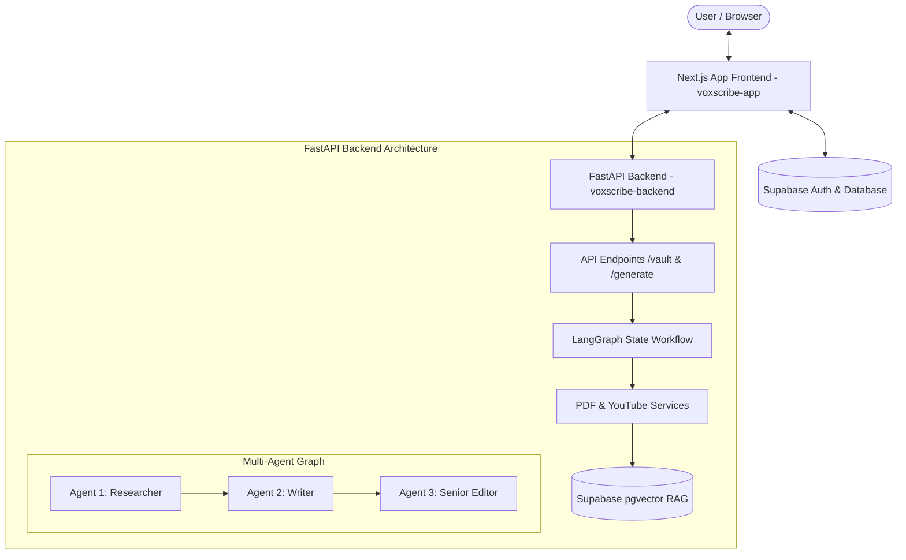

# VoxScribe AI - Codebase & Function Reference (`project.md`)

This document provides a comprehensive technical overview of the **VoxScribe AI** project, detailing every directory, file, data schema, function, component, API endpoint, and AI agent node in the system.

---

## 1. System Architecture Overview

VoxScribe AI is a full-stack, multi-agent AI platform that converts YouTube video transcripts into high-quality blog posts formatted in the user's personal brand voice using Retrieval-Augmented Generation (RAG).

---

## 2. Workspace Root (`/`)

Location: `D:\VoxScribe`

* **[`package.json`](file:///D:/VoxScribe/package.json)**
  * **Purpose**: Workspace manifest for root-level npm operations and script definitions.
* **[`README.md`](file:///D:/VoxScribe/README.md)**
  * **Purpose**: Project setup documentation, architectural overview, and quick-start instructions for running frontend, backend, and Supabase.
* **[`.env.example`](file:///D:/VoxScribe/.env.example)**
  * **Purpose**: Environment variable template for Supabase credentials, Groq API key, and HuggingFace API key.
* **[`.gitignore`](file:///D:/VoxScribe/.gitignore)**
  * **Purpose**: Declares files and directories ignored by Git tracking (e.g., `.venv`, `node_modules`, `.env`).

---

## 3. Database Layer (`/supabase`)

Location: `D:\VoxScribe\supabase`

* **[`schema.sql`](file:///D:/VoxScribe/supabase/schema.sql)**
  * **Purpose**: PostgreSQL database setup script for Supabase pgvector storage.
  * **Key Components**:
    1. **`CREATE EXTENSION IF NOT EXISTS vector;`**: Enables `pgvector` extension for vector embedding storage and similarity search.
    2. **`public.documents` Table**: Stores vector embeddings (`vector(384)`) of user PDF writing samples linked to `user_id`. Includes an `ivfflat` index `documents_embedding_idx` for fast cosine similarity lookups.
    3. **`public.blog_posts` Table**: Stores historical generated blog posts associated with each user.
    4. **`match_documents(...)` RPC Function**: Pl/pgSQL function executing cosine similarity search (`1 - (d.embedding <=> query_embedding)`) to return relevant writing style chunks for a specific `match_user_id`.

---

## 4. Backend Application (`/voxscribe-backend`)

Location: `D:\VoxScribe\voxscribe-backend`

### Root Backend Files

* **[`main.py`](file:///D:/VoxScribe/voxscribe-backend/main.py)**
  * **Purpose**: Local entrypoint script for launching the FastAPI server.
  * **Functions / Logic**:
    * `if __name__ == "__main__": uvicorn.run("app.main:app", host="127.0.0.1", port=8000, reload=True)`: Boots Uvicorn dev server.
* **[`agent.py`](file:///D:/VoxScribe/voxscribe-backend/agent.py)**
  * **Purpose**: Top-level export module providing direct access to key instances (`app`, `embeddings`, `supabase`).
* **[`requirements.txt`](file:///D:/VoxScribe/voxscribe-backend/requirements.txt)**
  * **Purpose**: Lists Python package dependencies (`fastapi`, `uvicorn`, `langchain`, `langgraph`, `langchain-groq`, `langchain-huggingface`, `supabase`, `youtube-transcript-api`, `pymupdf`, `python-dotenv`).

---

### Application Configuration & Core (`/app` & `/app/core`)

* **[`app/config.py`](file:///D:/VoxScribe/voxscribe-backend/app/config.py)**
  * **Purpose**: Centralized application configuration.
  * **Classes & Objects**:
    * `Settings`: Dataclass/object loading variables from `.env` via `python-dotenv` (`PROJECT_NAME`, `PROJECT_VERSION`, `SUPABASE_URL`, `SUPABASE_SERVICE_KEY`, `GROQ_API_KEY`, `HUGGINGFACE_API_KEY`).
    * `settings`: Global singleton instance of `Settings`.
* **[`app/main.py`](file:///D:/VoxScribe/voxscribe-backend/app/main.py)**
  * **Purpose**: Primary FastAPI application factory.
  * **Functions / Logic**:
    * Initializes `app = FastAPI(...)`.
    * Configures `CORSMiddleware` to allow cross-origin requests from the frontend.
    * Mounts `api_router` from `app.api.router`.
* **[`app/core/llm.py`](file:///D:/VoxScribe/voxscribe-backend/app/core/llm.py)**
  * **Purpose**: Factory for initializing LLM clients.
  * **Functions**:
    * `get_llm(temperature: float = 0.7) -> ChatGroq`: Returns a `ChatGroq` model instance (`llama-3.1-8b-instant`) configured with `settings.GROQ_API_KEY`.
* **[`app/core/embeddings.py`](file:///D:/VoxScribe/voxscribe-backend/app/core/embeddings.py)**
  * **Purpose**: Configures vector embedding generation model.
  * **Functions & Instances**:
    * `get_embeddings_model()`: Tries initializing `HuggingFaceEndpointEmbeddings` (`sentence-transformers/all-MiniLM-L6-v2`) if `HUGGINGFACE_API_KEY` is present; falls back to local `HuggingFaceEmbeddings`.
    * `embeddings`: Global singleton instance of embedding model.

---

### Data Schemas (`/app/schemas`)

* **[`app/schemas/generate.py`](file:///D:/VoxScribe/voxscribe-backend/app/schemas/generate.py)**
  * **Classes**:
    * `GenerateRequest(BaseModel)`: Request payload containing `youtube_url: str` and `user_id: Optional[str]`.
    * `GenerateResponse(BaseModel)`: Response payload containing `status: str`, `blog_post: Optional[str]`, and `message: Optional[str]`.
* **[`app/schemas/vault.py`](file:///D:/VoxScribe/voxscribe-backend/app/schemas/vault.py)**
  * **Classes**:
    * `VaultUploadResponse(BaseModel)`: Response payload containing `status: str`, `message: str`, and `saved_chunks: Optional[int]`.

---

### Business Logic Services (`/app/services`)

* **[`app/services/pdf_service.py`](file:///D:/VoxScribe/voxscribe-backend/app/services/pdf_service.py)**
  * **Functions**:
    * `extract_text_from_pdf(pdf_bytes: bytes) -> str`: Uses PyMuPDF (`fitz.open`) to extract raw text content page-by-page from raw PDF binary data.
    * `chunk_text(text: str, max_chunk_size=800, overlap=100) -> list[str]`: Splits raw text into paragraph-aware semantic chunks with sliding overlap to preserve sentence context.
* **[`app/services/supabase_service.py`](file:///D:/VoxScribe/voxscribe-backend/app/services/supabase_service.py)**
  * **Functions & Instances**:
    * `get_supabase_client() -> Client | None`: Initializes the Supabase client using `SUPABASE_URL` and `SUPABASE_SERVICE_KEY`.
    * `supabase`: Global instance of Supabase `Client`.
    * `save_document_chunks(user_id: str, chunks: list[str]) -> int`: Generates 384-dimensional vector embeddings for each chunk via `embeddings.embed_query` and inserts records into `public.documents`. Returns total saved chunk count.
    * `search_brand_voice(user_id: str, query_text: str, match_count=3) -> list[str]`: Embeds the query text and executes the `match_documents` RPC call in Supabase to fetch top matching brand writing style passages.
* **[`app/services/youtube_service.py`](file:///D:/VoxScribe/voxscribe-backend/app/services/youtube_service.py)**
  * **Functions**:
    * `extract_youtube_id(url: str) -> str | None`: Regular expression parser extracting 11-character YouTube video IDs from standard URLs, short links, embeds, and Shorts.
    * `fetch_transcript(url: str) -> tuple[str | None, str | None]`: Uses `YouTubeTranscriptApi` to fetch transcript items and join them into a single string. Returns `(transcript_text, error_message)`.

---

### API Router & Endpoints (`/app/api`)

* **[`app/api/router.py`](file:///D:/VoxScribe/voxscribe-backend/app/api/router.py)**
  * **Purpose**: Master API Router combining sub-routers for `/`, `/vault`, and `/generate`.
* **[`app/api/endpoints/health.py`](file:///D:/VoxScribe/voxscribe-backend/app/api/endpoints/health.py)**
  * **Endpoints**:
    * `GET /`: `read_root()` returning health status (`"online"`), project name, and version.
* **[`app/api/endpoints/vault.py`](file:///D:/VoxScribe/voxscribe-backend/app/api/endpoints/vault.py)**
  * **Endpoints**:
    * `POST /vault/upload`: `upload_to_vault(file: UploadFile, user_id: str)` validates PDF file format, extracts text, chunks it, embeds it into Supabase pgvector, and returns a `VaultUploadResponse`.
* **[`app/api/endpoints/generate.py`](file:///D:/VoxScribe/voxscribe-backend/app/api/endpoints/generate.py)**
  * **Endpoints**:
    * `POST /generate`: `generate_blog(request: GenerateRequest)` receives `youtube_url` and `user_id`, invokes the multi-agent `agent_graph`, and returns the final generated Markdown post inside `GenerateResponse`.

---

### Multi-Agent Workflow Engine (`/app/agents`)

* **[`app/agents/state.py`](file:///D:/VoxScribe/voxscribe-backend/app/agents/state.py)**
  * **Classes**:
    * `GraphState(TypedDict)`: Global state dictionary passed across nodes in the graph (`youtube_url`, `user_id`, `transcript`, `outline`, `brand_voice`, `draft`, `final_post`, `error`).
* **[`app/agents/graph.py`](file:///D:/VoxScribe/voxscribe-backend/app/agents/graph.py)**
  * **Functions & Instances**:
    * `build_graph()`: Constructs a `StateGraph(GraphState)` connecting `researcher` -> `writer` -> `editor` -> `END`.
    * `agent_graph`: Global compiled graph app instance ready for `.invoke()`.
* **[`app/agents/nodes/researcher.py`](file:///D:/VoxScribe/voxscribe-backend/app/agents/nodes/researcher.py)**
  * **Functions**:
    * `researcher_node(state: GraphState) -> dict`: **Agent 1 (Researcher)**. Fetches the YouTube transcript using `fetch_transcript(url)` and prompts Groq LLM to generate a structured blog outline.
* **[`app/agents/nodes/writer.py`](file:///D:/VoxScribe/voxscribe-backend/app/agents/nodes/writer.py)**
  * **Functions**:
    * `writer_node(state: GraphState) -> dict`: **Agent 2 (Writer)**. Queries `search_brand_voice` in Supabase pgvector using the generated outline to retrieve writing style samples. Prompts LLM to draft a full post mimicking the user's exact tone and vocabulary.
* **[`app/agents/nodes/editor.py`](file:///D:/VoxScribe/voxscribe-backend/app/agents/nodes/editor.py)**
  * **Functions**:
    * `editor_node(state: GraphState) -> dict`: **Agent 3 (SEO Editor)**. Receives draft blog post, generates a high-converting H1 title, cleans up Markdown headers and lists, and outputs the final post.

---

## 5. Frontend Application (`/voxscribe-app`)

Location: `D:\VoxScribe\voxscribe-app`

### Pages & App Router (`/app`)

* **[`app/layout.tsx`](file:///D:/VoxScribe/voxscribe-app/app/layout.tsx)**
  * **Purpose**: Root layout component setting up HTML tags, fonts (Inter/Geist), and metadata for the entire frontend.
* **[`app/page.tsx`](file:///D:/VoxScribe/voxscribe-app/app/page.tsx)**
  * **Purpose**: Core application page component (`Home`).
  * **State & Functions**:
    * `user`: Tracks active Supabase user session (`UserProfile`).
    * `handleAuth(email, pass, isSignUp)`: Authenticates user via Supabase Auth client (`signUp` or `signInWithPassword`).
    * `handleFileUpload(e)`: Uploads writing sample PDF to backend `/vault/upload` endpoint.
    * `handleGenerate(e)`: Triggers post generation workflow via backend `/generate` endpoint and saves finished posts to Supabase `blog_posts` table.
* **[`app/globals.css`](file:///D:/VoxScribe/voxscribe-app/app/globals.css)**
  * **Purpose**: Styling entrypoint importing Tailwind CSS primitives and defining custom font utilities and animations.
* **[`app/protected/page.tsx`](file:///D:/VoxScribe/voxscribe-app/app/protected/page.tsx)**
  * **Purpose**: `ProtectedPage` displays secure user claims and environment system status.
  * **Functions**: `UserDetails()` server component inspecting current Supabase session claims.
* **[`app/protected/layout.tsx`](file:///D:/VoxScribe/voxscribe-app/app/protected/layout.tsx)**
  * **Purpose**: `ProtectedLayout` wraps protected pages with top navigation, theme switcher, and deployment status.
* **[`app/auth/...`](file:///D:/VoxScribe/voxscribe-app/app/auth)**
  * `confirm/route.ts`: Next.js server route handling email verification token exchange.
  * `login/page.tsx`, `sign-up/page.tsx`, `forgot-password/page.tsx`, `update-password/page.tsx`, `sign-up-success/page.tsx`: Pages for respective authentication sub-views.

---

### Dashboard & UI Components (`/components`)

* **[`components/dashboard/BrandVaultCard.tsx`](file:///D:/VoxScribe/voxscribe-app/components/dashboard/BrandVaultCard.tsx)**
  * **Component**: Interactive drag-and-drop file upload section allowing users to upload PDF writing samples to train their Brand Voice.
* **[`components/dashboard/GeneratePostCard.tsx`](file:///D:/VoxScribe/voxscribe-app/components/dashboard/GeneratePostCard.tsx)**
  * **Component**: Input card accepting YouTube video URLs and submitting generation requests.
* **[`components/dashboard/GenerationProgress.tsx`](file:///D:/VoxScribe/voxscribe-app/components/dashboard/GenerationProgress.tsx)**
  * **Component**: Animated multi-step progress indicator showing transcript fetching, brand voice vector retrieval, and agent drafting steps.
* **[`components/dashboard/BlogResultViewer.tsx`](file:///D:/VoxScribe/voxscribe-app/components/dashboard/BlogResultViewer.tsx)**
  * **Component**: Markdown renderer component displaying the finished blog post using `react-markdown`, with author avatar, date header, and copy-to-clipboard functionality.
* **[`components/auth/AuthCard.tsx`](file:///D:/VoxScribe/voxscribe-app/components/auth/AuthCard.tsx)**
  * **Component**: Glassmorphism authentication modal card handling Sign In and Sign Up form switching.
* **[`components/layout/Sidebar.tsx`](file:///D:/VoxScribe/voxscribe-app/components/layout/Sidebar.tsx)**
  * **Component**: Desktop navigation sidebar containing VoxScribe branding, tab navigation buttons (Dashboard vs History), and current user session profile card with sign-out trigger.
* **UI Components (`/components/ui`)**:
  * `button.tsx`, `card.tsx`, `input.tsx`, `label.tsx`, `badge.tsx`, `checkbox.tsx`, `dropdown-menu.tsx`: Accessible UI primitives.

---

### Utilities, Libraries & Middleware (`/lib`, `/middleware.ts`)

* **[`lib/api.ts`](file:///D:/VoxScribe/voxscribe-app/lib/api.ts)**
  * **Functions & Constants**:
    * `DEFAULT_API_BASE_URL`: `"http://localhost:8000"`.
    * `API_BASE_URL`: Resolves `NEXT_PUBLIC_API_URL` or defaults to `DEFAULT_API_BASE_URL`.
    * `buildApiUrl(path: string) -> string`: Normalizes backend URL paths.
    * `fetchBackend(path: string, options?: RequestInit) -> Promise<Response>`: Performs `fetch` calls targeting the FastAPI backend.
* **[`lib/utils.ts`](file:///D:/VoxScribe/voxscribe-app/lib/utils.ts)**
  * **Functions & Constants**:
    * `cn(...inputs)`: Combines `clsx` and `tailwind-merge` class names.
    * `hasEnvVars`: Boolean check verifying presence of Supabase URL and anon/publishable keys.
* **[`lib/supabase/client.ts`](file:///D:/VoxScribe/voxscribe-app/lib/supabase/client.ts)**
  * **Functions**: `createClient()` instantiates a Supabase browser client via `@supabase/ssr`.
* **[`lib/supabase/server.ts`](file:///D:/VoxScribe/voxscribe-app/lib/supabase/server.ts)**
  * **Functions**: `createClient()` instantiates a Supabase server client using Next.js `cookies()`.
* **[`lib/supabase/proxy.ts`](file:///D:/VoxScribe/voxscribe-app/lib/supabase/proxy.ts)**
  * **Functions**: `updateSession(request: NextRequest)` refreshes authentication session cookies and enforces protected path redirects.
* **[`middleware.ts`](file:///D:/VoxScribe/voxscribe-app/middleware.ts) & [`proxy.ts`](file:///D:/VoxScribe/voxscribe-app/proxy.ts)**
  * **Purpose**: Next.js request middleware intercepting requests and delegating session management to `updateSession`.
* **[`types/index.ts`](file:///D:/VoxScribe/voxscribe-app/types/index.ts)**
  * **Interfaces**: Defines TypeScript types `UserProfile`, `VaultUploadResponse`, `BlogGenerateResponse`, and `BlogPost`.
